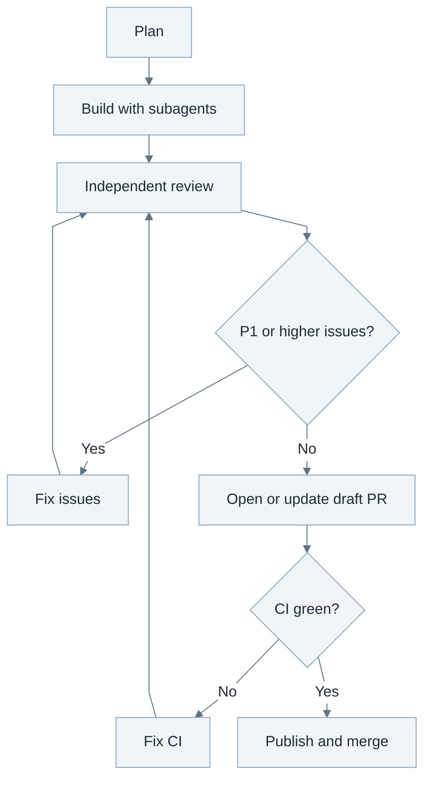

Working with coding agents is a skill. Here are the levels I progressed through over the last year.

## Level 1: Manual prompting

When you first work in an agentic harness you don't quite trust the thing. You treat it like a powerful auto-complete. Write a test for this. Handle this exception here. Then you gradually come to trust the thing, and before you know it you tell it to [port a TypeScript CLI to Rust](https://github.com/jooh/devcontainer-rs). This won't go terribly well in a single prompt, as of November 2026 at least. You might end up with something that isn't quite what you wanted. Something quite broken even though it has lots of unit tests.

So you develop prompting strategies. Planning is a pretty good idea because it forces the model to read the existing code before it starts making edits, which reduces the risk of duplicated functionality. And it helps clarify your intent. If your intent is already clear enough the current frontier no longer strictly needs planning for up to moderate-scale work, but weaker models still benefit enormously.

When it's time to build, a prompt like [use red/green TDD](https://simonwillison.net/guides/agentic-engineering-patterns/red-green-tdd/) helps ensure the model won't write completely broken code. Again, at the frontier this seems less crucial in late 2026 but it remains useful.

The next thing you might hit on is doing a review pass after development is done. It's a good idea to clear the context first since the model might otherwise exhibit an all too human attachment to its own work. 

Then you ask the model to fix the issues, clear the context and go again. And you marvel at how many P0 and P1's it keeps finding. You end up in a review-fix loop that can churn for a while. It helps to instruct the model to only report P1 and above, and to only report issues in the current diff.

But all this reduces your contribution to a meat proxy. You type a review prompt, wait for the result. Tell the model to fix the issues. And you keep going again. Sure you're going a factor or two faster than without AI but surely this can be improved?

## Level 2: Structured prompting and subagents

Subagents make it possible to get out of manually prompting and managing session state. Because the new agents start with a prompt, the decision whether to clear context boils down to whether you should have the harness dispatch a subagent or not.

If you delegate all work to subagents your primary ends up in a coordinator role, dispatching builders, reviewers, and so on and inspecting their reported results. There is a potential speedup here but honestly I don't often see it in practice. The benefit is instead that it helps you work at a higher level of abstraction, where the coordinator can take care of a larger chunk of work without getting stuck in the weeds and running out of context window.

This overlaps with what Addy Osmani calls [loop engineering](https://addyosmani.com/blog/loop-engineering/): designing a system that prompts agents for you. But at this level we are still describing the loop in a prompt and trusting the model to follow it. It isn't really engineering at all in my book. We're still prompting.

At this level you might find yourself adopting shorthand prompts that act almost like invocations, kicking off large chunks of work in just a few words. You still prompt in an interactive harness, but maybe once an hour instead of every few minutes. For example, the review-fix loop we were managing manually before becomes "Use sub-agents to review, fix issues, repeat until no P1 or higher issues remain." Another helpful one is "Open a draft PR and babysit CI until it's green." Soon you find yourself adding on an instruction to merge the PR, and now you mostly never have to prompt in that session again.

## Level 3: Skills as orchestration

Skills make it possible to kick this abstraction up another level. Instead of prompting a couple of times per feature, maybe we can just put all the instructions in a single skill and tell the agent to use it. For example, an `Orchestrate.md` skill might describe this workflow:

This works well enough when the coordinating model is late 2026 frontier. But it's a bit like asking the LLM to perform arithmetic by chain of thought rather than giving it access to a calculator in a tool call. The model will follow your prompt reasonably well most of the time but there is no real guarantee that it will observe the intended development cycle exactly. You might worry in particular that if the task is a large one and the coordinating agent starts running out of context, it might easily forget to run the review agent before proceeding to PR.

It can also be tricky to control token usage when working with sub agents. Both Codex and Claude will burn through your limits in no time if you don't take steps to ensure the sub agents are simpler models, and that the loops won't churn excessively (it can be helpful to instruct the model that the review-fix loop must end after 3 rounds for example).

If we want to go even faster at this point we need to get away from all this prompting and move to a structured orchestration of the development process, but this is where things get hairy.

## Level 4: The software factory?

To overcome the limitations of prompt-based loop engineering we're going to need to turn the loop inside out. Instead of a harness orchestrating we are going to develop an orchestrator of harness invocations. We're probably going to have a backlog where the user writes tickets at a high level. Agents will pick up the tickets, refine them, create tasks, plan, execute, and deliver entire features on a silver platter to production.

Honestly, my personal GitHub is a ghost town of failed attempts to build gas towns of this nature. There was the one built in straight Python on pydantic.AI. There was the one using only shell scripts and GNU Make for orchestration. There were attempts to wrangle persistent execution engines like Temporal and DBOS. They're all technically viable solutions to different extents, but they share a common problem. They did not succeed in replacing the *awesome* chat UX that ChatGPT first pioneered with something that makes it possible to build faster without completely losing control. In the end I keep coming back to prompting in a coding harness.

That's not to say factories can't be useful. It's how some large software projects are built now ([how the Claude Code team works](https://claude.com/resources/articles/running-an-ai-native-engineering-org)). But it doesn't work well with greenfields development in my experience. For squashing bugs and handling CVEs in a production system I can totally see the value though!
